<div align="center">

# corne-hud

**Live OLED screens for the Corne split keyboard**

Clock, temperatures and battery, keyboard layout flash, music spectrum, a Bongo cat, 19 animations,
your own pictures and GIFs, drawing right on the screen — all driven from your computer over USB.

[](https://github.com/OlexiyOdarchuk/corne-hud/actions/workflows/ci.yml)
[](https://github.com/OlexiyOdarchuk/corne-hud/releases)


[](LICENSE)

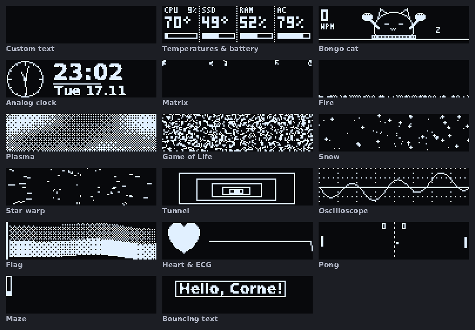

**English** · [Українська](README.uk.md)

</div>

---

## Contents

- [Features](#features)
- [Platforms](#platforms)
- [The window](#the-window)
- [Data from your computer](#data-from-your-computer)
- [Drawing](#drawing)
- [Built-in modes](#built-in-modes)
- [How it works](#how-it-works)
- [Installation](#installation)
- [Commands](#commands)
- [Language](#language)
- [Good to know](#good-to-know)
- [Project layout](#project-layout)

## Features

|  |  |
|---|---|
| 🖥️ **Mode per screen** | status, spaceship, pet, equalizer, clock/CPU/music, picture — separately for each half |
| ✨ **19 presets** | custom text (any language), temperatures & battery, audio spectrum and waveform, Bongo cat, analog clock, Matrix, fire, plasma, Game of Life, snow, star warp, tunnel, oscilloscope, flag, heart with ECG, Pong, maze, bouncing text |
| ⌨️ **Layout flash** | after switching the input language, EN / UA / DE… briefly appears on the screen |
| 🎵 **Sound** | a real spectrum and waveform of whatever is playing on the computer |
| 🐱 **Bongo cat** | taps along with every keypress and shows your typing speed |
| 🌡️ **Sensors** | CPU and GPU (or SSD) temperature, load, RAM, battery charge |
| 🎨 **Drawing** | pencil, shapes, fill, text, animation frames, 15 effects, live drawing straight onto the keyboard |
| 🖼️ **Pictures & GIFs** | PNG, JPG, GIF, BMP, WebP; dithering for halftones, threshold, invert, crop |
| ⏱️ **Clock & track** | time, CPU and RAM load, track title from the music player |
| 📺 **Frame stream** | anything 128×32 from stdin: video via `ffmpeg`, your own generators, games |
| ⌨️ **Headless** | a background service keeps the screens alive; everything is also available from the terminal |
| 🪶 **Lightweight** | Rust; the service running the “Fire” animation uses about 0.4% CPU and 6 MB RAM |

## Platforms

Linux is the main platform; Windows and macOS builds are new and experimental — reports from real
Windows/macOS setups are very welcome.

| | Linux | Windows | macOS |
|---|:---:|:---:|:---:|
| Screen modes, pictures, GIFs, drawing, presets, frame stream | ✅ | ✅ | ✅ |
| Clock, CPU and RAM load | ✅ | ✅ | ✅ |
| Layout flash | ✅ KDE Plasma | ✅ | ✅ |
| Track title | ✅ MPRIS | ✅ system media | ✅ Spotify, Music |
| Audio spectrum and waveform | ✅ PipeWire / PulseAudio | ✅ WASAPI | ✅ via [BlackHole](https://github.com/ExistentialAudio/BlackHole) |
| Bongo cat reacting to keypresses | ✅ | ✅ | ✅ Input Monitoring |
| Battery | ✅ | ✅ | ✅ |
| CPU / GPU temperatures | ✅ | — | — |
| Pauses while Vial is open | ✅ | — | — |

Issues and pull requests for the missing pieces are very welcome.

## The window

Three tabs: screen modes with a live preview of every preset, drawing, and your own pictures and GIFs.

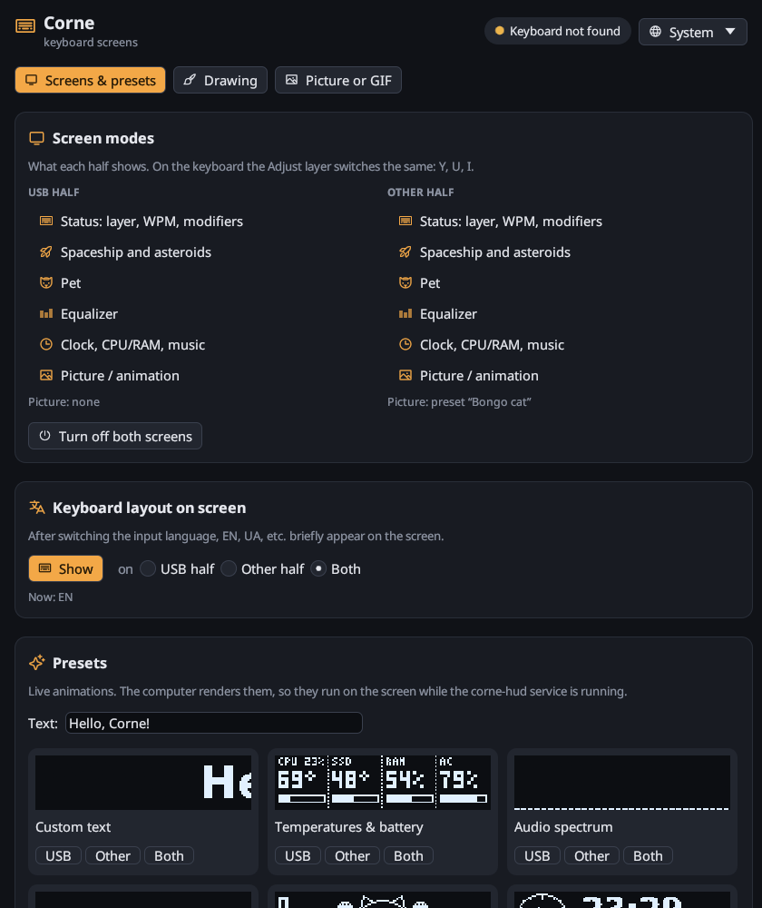

## Data from your computer

| | |
|:---:|:---:|
| 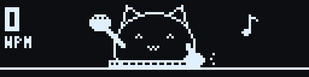<br>**Bongo cat** — paws tap with every keypress, typing speed on the left, falls asleep when idle | 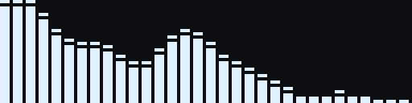<br>**Audio spectrum** — 32 bands from 40 Hz to 16 kHz, auto gain (the demo uses a test signal) |

- **Layout.** After switching the input language, `EN`, `UA`, etc. shows for 0.8 s, then the previous mode returns.
  Works in KDE Plasma (D-Bus `org.kde.keyboard`) and on Windows. You can turn it off or pick a half in the window.
  It is drawn over the built-in modes with protocol 2 firmware (the `firmware/` folder); with older firmware —
  only on a screen showing a picture or preset.
- **Sound** is captured from the default output, and only while a sound preset is on: via `parec` or `pw-record`
  (PipeWire / PulseAudio) on Linux, via WASAPI loopback on Windows. macOS does not let apps record system audio
  directly, so install [BlackHole 2ch](https://github.com/ExistentialAudio/BlackHole), create a *Multi-Output Device*
  with your speakers and BlackHole in *Audio MIDI Setup* and make it the output; corne-hud finds BlackHole by itself
  (macOS asks for microphone access once).
- **The cat** only counts keypresses and their timing, never which keys. On Linux it reads `/dev/input` and needs
  the `input` group or the udev rule from `packaging/70-corne-hud.rules`, which grants access to the Corne only.
  On Windows it uses a low-level keyboard hook (no admin rights needed); it does not see keys typed into
  windows running as administrator. On macOS it needs *Input Monitoring* permission (System Settings → Privacy & Security),
  macOS asks for it the first time.
- **Track title** comes from any MPRIS player via `playerctl` on Linux, from the system media controls on Windows
  (the same player shown next to the volume flyout) and from Spotify or Music on macOS (macOS asks once to allow it).
- **Sensors:** `coretemp` / `k10temp` / `zenpower`, GPU `amdgpu` / `nouveau` (otherwise the `nvme` SSD), battery from `/sys/class/power_supply`.
  On Windows and macOS the preset shows CPU load, RAM and battery: temperatures there need admin rights or a driver.
- **Layout** on macOS is read from the input source settings (`com.apple.HIToolbox`).

## Drawing

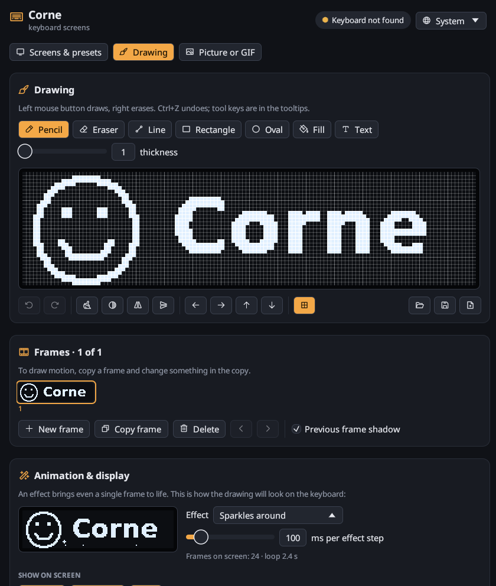

- **Tools:** pencil `B`, eraser `E`, line `L`, rectangle `R`, oval `O`, fill `F`, text `T`.
  The right mouse button does the opposite: the pencil erases, the fill fills with black.
- **Edits:** undo / redo (`Ctrl+Z`, `Ctrl+Shift+Z`), clear, invert, mirror, flip, shift by a pixel.
- **Frames:** new, copy, delete, reorder; the previous frame shows as a shadow (onion skin) to help draw motion.
- **Live:** every stroke appears on the chosen keyboard screen immediately.
- **Files:** open a picture or GIF as a base, save the result as PNG or GIF.
- The drawing saves itself and waits for the next time you open the window.

**Effects** bring even a single frame to life. Drawing frames and the effect have separate speeds,
so an animated drawing can also scroll or sparkle:

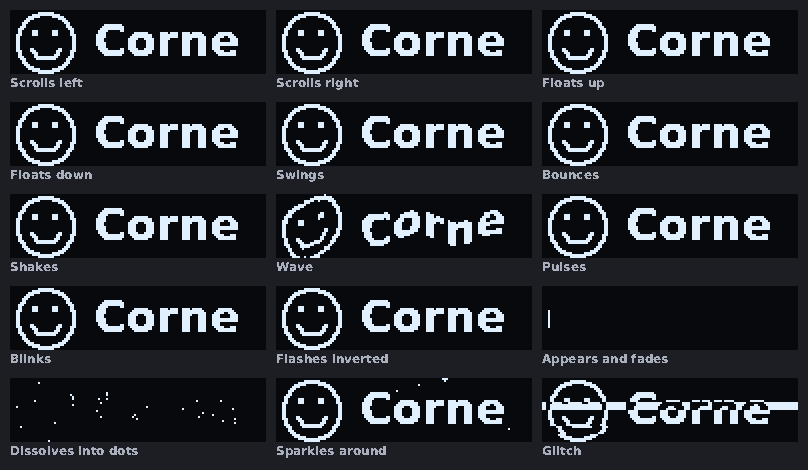

Open the window straight on the drawing tab: `corne-hud draw` (or the “Drawing” action in the app menu).

## Built-in modes

These modes are drawn by the firmware itself and work without a computer:

| | |
|:---:|:---:|
| 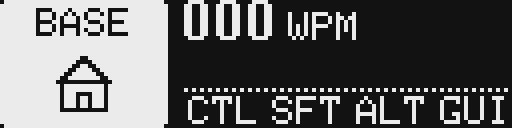<br>**Status** — layer, WPM, modifiers | 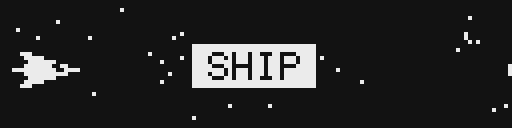<br>**Spaceship** — flies faster while you type |
| 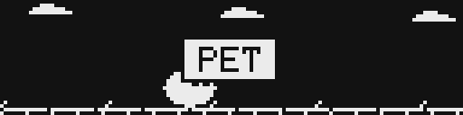<br>**Pet** — runs when you type, sleeps when you don't | 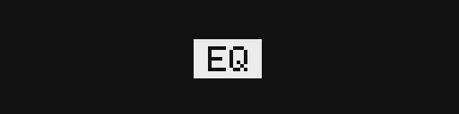<br>**Equalizer** — bars driven by keypresses |
| 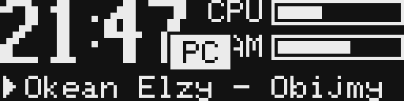<br>**Clock, CPU/RAM, music** — data from corne-hud | |

Switching from the keyboard: Adjust layer, `Y` / `U` / `I` (details in [firmware/README.md](firmware/README.md)).

## How it works

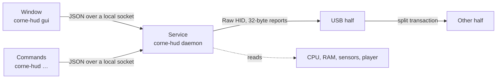

- There is **one service** per system: it holds the keyboard's Raw HID interface, renders presets, sends the clock and track,
  reconnects by itself and restores pictures after a restart.
- The local socket is a Unix socket on Linux and macOS and `127.0.0.1:47653` on Windows.
  On Linux the keyboard is reached via `/dev/hidraw*`, elsewhere via hidapi.
- A frame is 512 bytes. **Only the changed 28-byte chunks** are sent, so animations run at up to 20 frames per second.
- The other half gets frames from the main one in 60-byte chunks.
- The protocol is described in [PROTOCOL.md](PROTOCOL.md).

## Installation

### 1. Firmware

`corne-hud` works with the firmware from the [`firmware/`](firmware/README.md) folder: Vial/QMK for the Corne v3 on an RP2040 Pro Micro.
Ready `.uf2` files for the left and right halves are in the [releases](https://github.com/OlexiyOdarchuk/corne-hud/releases).

### 2. The app

Download from the [latest release](https://github.com/OlexiyOdarchuk/corne-hud/releases/latest):

| System | File | Install |
|---|---|---|
| Debian, Ubuntu, Mint | `corne-hud_*_amd64.deb` / `_arm64.deb` | `sudo apt install ./corne-hud_*.deb` |
| Fedora, openSUSE | `corne-hud-*.x86_64.rpm` / `.aarch64.rpm` | `sudo dnf install ./corne-hud-*.rpm` |
| Arch | [`packaging/aur/PKGBUILD`](packaging/aur/PKGBUILD) | `makepkg -si` in that folder |
| Any Linux | `corne-hud-*-x86_64.AppImage` | `chmod +x` and run; add the udev rule (step 3) |
| Any Linux | `corne-hud-*-x86_64.flatpak` | `flatpak install --user corne-hud-*.flatpak`; add the udev rule (step 3) |
| Any Linux | `corne-hud-*-linux-*.tar.gz` | the binary plus the desktop file, service and udev rule |
| Windows 10/11 | `corne-hud-*-windows-x86_64.zip` or `.exe` | just run it, no driver needed |
| macOS 11+ | `corne-hud-*-macos-universal.dmg` | drag *Corne HUD* to Applications |

The `.deb`, `.rpm` and AUR packages install the udev rule and the user service by themselves.

Builds are not code-signed yet. Windows SmartScreen may warn: *More info → Run anyway*.
On macOS, open the app with right-click → *Open* the first time, or run
`xattr -dr com.apple.quarantine "/Applications/Corne HUD.app"`. The CLI lives at
`"/Applications/Corne HUD.app/Contents/MacOS/corne-hud"`, and there is also a separate `-cli.tar.gz`.

**From source** — needs [Rust](https://rustup.rs) 1.88+:

```sh
cargo install --git https://github.com/OlexiyOdarchuk/corne-hud
```

Optional on Linux: `playerctl` (track title), `parec` or `pw-record` (audio spectrum), `busctl` and KDE Plasma
(layout), `fontconfig` with any Sans font (text in presets and drawing).

### 3. Keyboard access without root (Linux)

Packages do this for you. For AppImage, Flatpak, the tarball and `cargo install`, add the udev rule.
It grants access to the Raw HID interface (screens) and to keypresses of the Corne only (for the cat):

```sh
curl -LO https://raw.githubusercontent.com/OlexiyOdarchuk/corne-hud/main/packaging/70-corne-hud.rules
sudo install -Dm644 70-corne-hud.rules /etc/udev/rules.d/70-corne-hud.rules
sudo udevadm control --reload && sudo udevadm trigger
```

The file name matters: `uaccess` rules must sort before `73-seat-late.rules`. If you installed an older
`99-corne.rules`, remove it.

Windows and macOS need nothing here.

### 4. App menu and autostart (Linux, `cargo install`)

```sh
# menu entry and icon (full path: the menu does not see ~/.cargo/bin from shell settings)
sed "s|^Exec=corne-hud|Exec=$HOME/.cargo/bin/corne-hud|" packaging/corne-hud.desktop \
  > ~/.local/share/applications/io.github.OlexiyOdarchuk.CorneHud.desktop
install -Dm644 packaging/icons/corne-hud.svg \
  ~/.local/share/icons/hicolor/scalable/apps/io.github.OlexiyOdarchuk.CorneHud.svg

# start the service on login: clock and animations work without the window open
install -Dm644 packaging/corne-hud.service ~/.config/systemd/user/corne-hud.service
systemctl --user enable --now corne-hud
```

With the `.deb` / `.rpm` / AUR package only the last command is needed: `systemctl --user enable --now corne-hud`.

Without autostart, the service starts by itself as soon as you open the window or run any command.

## Commands

```sh
corne-hud                                   # the window
corne-hud draw                              # the window, on the drawing tab
corne-hud status                            # keyboard and screen status

corne-hud screen side pet                   # main | side | both  ×  status ship pet eq pc image
corne-hud presets                           # list presets
corne-hud preset fire --screen side
corne-hud text "Hello from Corne!" --screen main

corne-hud image cat.gif --screen main       # --fit contain|cover|stretch, --no-dither --threshold 100, --invert
corne-hud clear                             # remove pictures
corne-hud off / on                          # turn the screens off / on
```

`main` is the half plugged into USB, `side` is the other one.

### Frame stream

512 bytes per frame in the screen format, or `--gray` — 4096 bytes (128×32, one byte per pixel):

```sh
ffmpeg -re -i video.mp4 \
  -vf "scale=128:32:force_original_aspect_ratio=decrease,pad=128:32:(ow-iw)/2:(oh-ih)/2" \
  -f rawvideo -pix_fmt gray - | corne-hud stream --gray --screen side
```

## Language

The interface is in English and Ukrainian. The system language is used by default; switch it with the globe menu
in the top right corner of the window, or set `CORNE_HUD_LANG=en` / `uk` for a single run.

Translations live in [`locales/`](locales). To add a language, copy `locales/en.yml` to `locales/<code>.yml`,
translate it and add the code to `LANGS` in [`src/i18n.rs`](src/i18n.rs). `cargo test` checks that every file has the same keys.

## Good to know

- Pictures and presets are saved in the config folder (`~/.config/corne-hud/` on Linux,
  `~/Library/Application Support/corne-hud/` on macOS, `%APPDATA%\corne-hud\` on Windows) and come back after a reconnect.
  The keyboard itself does not remember them: without the service, the “picture” mode is empty after a power cycle.
- The font of the built-in “Clock” mode is ASCII only, so Cyrillic in track titles is transliterated.
  Presets and drawing use the computer's fonts and show any language.
- When **Vial** (the app or vial.rocks) opens the keyboard on Linux, the service pauses and resumes as soon as Vial closes:
  the keyboard answers every packet to everyone who opened it, and Vial would take a foreign answer for its own.
  On Windows and macOS, quit the service (`corne-hud daemon` in the task manager / Activity Monitor) before using Vial.

## Project layout

```
src/
  main.rs       commands
  gui.rs        the window
  paint.rs      drawing tab
  draw.rs       shapes, frames, animation effects
  presets.rs    animated presets
  live.rs       data presets: sound, cat, sensors
  audio.rs      audio capture and spectrum (FFT)
  keys.rs       keypresses for the cat
  pixfont.rs    3×5 pixel font
  daemon.rs     background service
  device.rs     Raw HID: finding the keyboard, sending frames
  ipc.rs        requests between the window/commands and the service
  oled.rs       frame format, picture conversion, PNG/GIF
  media.rs      GIFs for this README (corne-hud docs-media docs/media)
  sysinfo.rs    CPU, RAM, temperatures, battery, track, layout
  platform.rs   OS differences: config folder, fonts, Flatpak, AppImage
  i18n.rs       interface language
locales/        translations
firmware/       Vial (QMK) firmware and a screen simulator
packaging/      deb/rpm/AUR/AppImage/Flatpak/macOS files, systemd service, desktop file, udev rule, icons
docs/media/     GIFs and screenshots for this README
```

Tests: `cargo test` (shapes, fill, effects, edit history, presets, FFT, D-Bus parsing, translations).
Window screenshots for this README: `docs/screenshots.sh` (renders in a hidden nested KWin).
Releases are built by [`.github/workflows/release.yml`](.github/workflows/release.yml) when a `v*` tag is pushed.

## License

The app is [MIT](LICENSE). The firmware in `firmware/` is GPL-2.0-or-later, like QMK it is built on.
