<div align="center">

# corne-hud

**Живі OLED-екрани для розділеної клавіатури Corne**

Годинник, температури й батарея, розкладка UA/EN, спектр музики, котик-барабанщик, 19 анімацій,
свої картинки й GIF, малювання прямо на екрані — все це з комп'ютера через USB.

[](https://github.com/OlexiyOdarchuk/corne-hud/actions/workflows/ci.yml)
[](https://www.rust-lang.org)


[](LICENSE)

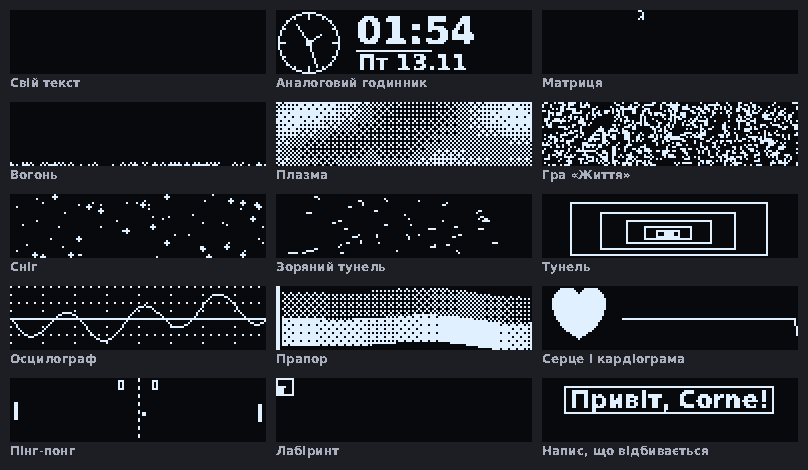

</div>

---

## Зміст

- [Можливості](#можливості)
- [Вікно](#вікно)
- [Дані з комп'ютера](#дані-з-компютера)
- [Малювання](#малювання)
- [Вбудовані режими](#вбудовані-режими)
- [Як це працює](#як-це-працює)
- [Встановлення](#встановлення)
- [Команди](#команди)
- [Корисно знати](#корисно-знати)
- [Структура](#структура)
- [In English](#in-english)

## Можливості

|  |  |
|---|---|
| 🖥️ **Режим кожного екрана** | статус, корабель, вихованець, еквалайзер, годинник/CPU/музика, картинка — окремо для кожної половини |
| ✨ **19 заготовок** | свій текст (будь-якою мовою), температури й батарея, спектр і хвиля звуку, Bongo-кіт, аналоговий годинник, матриця, вогонь, плазма, гра «Життя», сніг, зоряний тунель, тунель, осцилограф, прапор, серце з кардіограмою, пінг-понг, лабіринт, напис, що відбивається |
| ⌨️ **Розкладка** | після перемикання мови на екрані на мить з'являється EN / UA |
| 🎵 **Звук** | справжній спектр і хвиля того, що грає на комп'ютері |
| 🐱 **Bongo-кіт** | б'є лапками з кожним натисканням і показує швидкість друку |
| 🌡️ **Датчики** | температура процесора й відеокарти (або SSD), завантаження, RAM, заряд батареї |
| 🎨 **Малювання** | олівець, фігури, заливка, текст, кадри анімації, 15 ефектів, малювання наживо просто на клавіатурі |
| 🖼️ **Картинки й GIF** | PNG, JPG, GIF, BMP, WebP; розсіювання для півтонів, поріг, інверсія, кадрування |
| ⏱️ **Годинник і трек** | час, завантаження CPU і RAM, назва треку з будь-якого MPRIS-плеєра |
| 📺 **Потік кадрів** | будь-що 128×32 зі stdin: відео через `ffmpeg`, свої генератори, ігри |
| ⌨️ **Без вікна** | фонова служба тримає екрани живими, а всі дії доступні з терміналу |
| 🪶 **Легкий** | Rust; служба з анімацією «Вогонь» — близько 0,4 % CPU і 6 МБ RAM |

## Вікно

Три вкладки: режими екранів із живим переглядом заготовок, малювання, свої картинки й GIF.

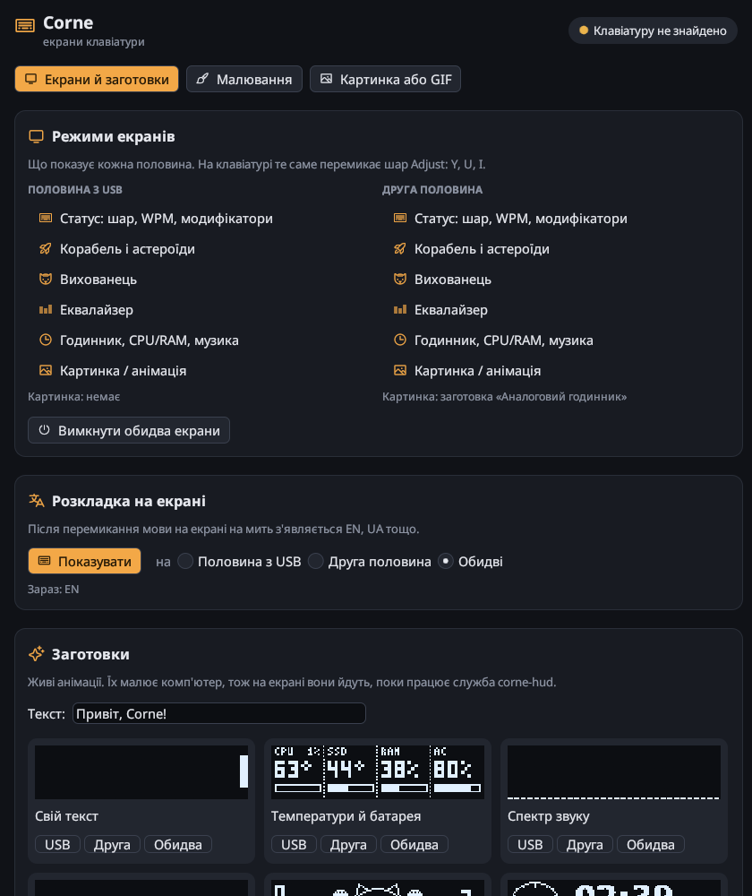

## Дані з комп'ютера

| | |
|:---:|:---:|
| 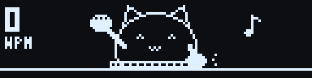<br>**Bongo-кіт** — лапки б'ють з кожним натисканням, зліва швидкість друку, без дії засинає | 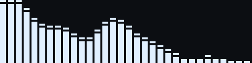<br>**Спектр звуку** — 32 смуги від 40 Гц до 16 кГц, автопідсилення (на демо — тестовий сигнал) |

- **Розкладка.** Після перемикання мови на екрані на 0,8 с з'являється `EN`, `UA` тощо, потім повертається
  попередній режим. Працює в KDE Plasma (D-Bus `org.kde.keyboard`). У вікні можна вимкнути показ або вибрати половину.
  Поверх вбудованих режимів — з прошивкою протоколу 2 (папка `firmware/`); зі старішою — лише на екрані з картинкою чи заготовкою.
- **Звук** захоплюється з виходу за замовчуванням через `parec` або `pw-record` (PipeWire / PulseAudio)
  і лише поки увімкнена звукова заготовка.
- **Котик** читає з `/dev/input` лише факт натискання, без кодів клавіш. Потрібна група `input`
  або правило udev з `packaging/99-corne.rules`, яке відкриває доступ тільки до Corne.
- **Датчики:** `coretemp` / `k10temp` / `zenpower`, відеокарта `amdgpu` / `nouveau` (якщо немає — SSD `nvme`), батарея з `/sys/class/power_supply`.

## Малювання

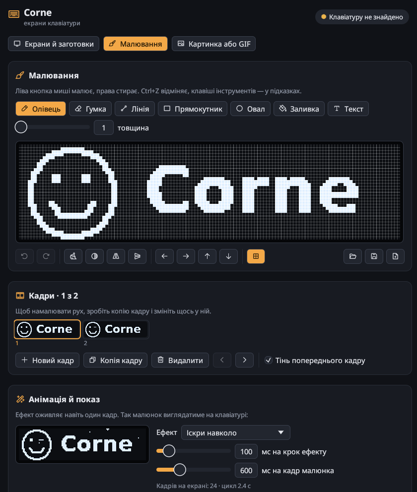

- **Інструменти:** олівець `B`, гумка `E`, лінія `L`, прямокутник `R`, овал `O`, заливка `F`, текст `T`.
  Права кнопка миші робить протилежне: олівцем стирає, заливкою заливає чорним.
- **Правки:** відмінити / повторити (`Ctrl+Z`, `Ctrl+Shift+Z`), очистити, інвертувати, віддзеркалити,
  перевернути, зсунути на піксель.
- **Кадри:** новий, копія, видалення, перестановка; попередній кадр видно тінню, щоб малювати рух.
- **Наживо:** кожен штрих одразу з'являється на вибраному екрані клавіатури.
- **Файли:** відкрити картинку чи GIF як основу, зберегти результат у PNG або GIF.
- Малюнок зберігається сам і чекає наступного відкриття вікна.

**Ефекти** оживляють навіть один кадр. Кадри малюнка й ефект мають окремі швидкості, тож анімований малюнок
може ще й біжати рядком чи іскритися:

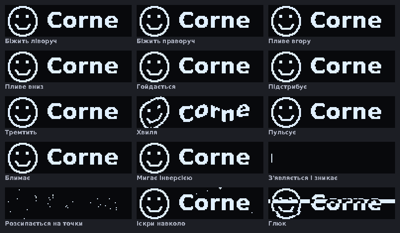

Відкрити вікно одразу на малюванні: `corne-hud draw` (або дія «Малювання» в меню застосунків).

## Вбудовані режими

Ці режими малює сама прошивка, вони працюють і без комп'ютера:

| | |
|:---:|:---:|
| 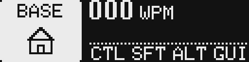<br>**Статус** — шар, WPM, модифікатори | 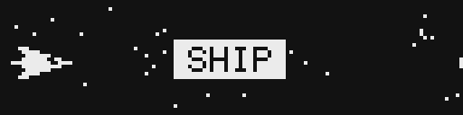<br>**Корабель** — летить швидше, коли друкуєте |
| 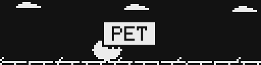<br>**Вихованець** — бігає від набору, спить у тиші | 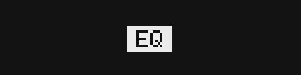<br>**Еквалайзер** — стовпчики від натискань |
| 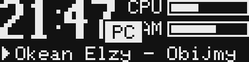<br>**Годинник, CPU/RAM, музика** — дані від corne-hud | |

Перемикання з клавіатури: шар Adjust, `Y` / `U` / `I` (деталі — у [firmware/README.md](firmware/README.md)).

## Як це працює

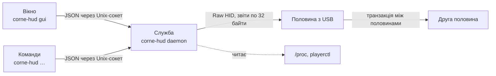

- **Служба** одна на систему: тримає `/dev/hidraw*` клавіатури, малює заготовки, шле годинник і трек,
  перепідключається сама і повертає картинки на екрани після перезапуску.
- Кадр — 512 байт. Передаються **лише змінені шматки** по 28 байт, тож анімації йдуть до 20 кадрів на секунду.
- Друга половина отримує кадри від головної шматками по 60 байт.
- Протокол описано в [PROTOCOL.md](PROTOCOL.md).

## Встановлення

### 1. Прошивка

`corne-hud` працює з прошивкою з папки [`firmware/`](firmware/README.md): Vial/QMK для Corne v3 на RP2040 Pro Micro.
Готові `.uf2` для лівої й правої половини — у [релізах](https://github.com/OlexiyOdarchuk/corne-hud/releases).

### 2. Програма

Потрібні Linux і [Rust](https://rustup.rs) 1.88+. Необов'язково: `playerctl` (назва треку), `parec` або `pw-record`
(спектр звуку), `busctl` і KDE Plasma (розкладка), `fontconfig` з будь-яким шрифтом Sans (текст у заготовках і малюванні).

```sh
cargo install --git https://github.com/OlexiyOdarchuk/corne-hud
```

### 3. Доступ до клавіатури без root

Правило дає доступ до Raw HID (екрани) і до натискань саме Corne (для котика):

```sh
sudo install -Dm644 packaging/99-corne.rules /etc/udev/rules.d/99-corne.rules
sudo udevadm control --reload && sudo udevadm trigger
```

### 4. Меню застосунків і автозапуск

```sh
# ярлик (повний шлях: меню не бачить ~/.cargo/bin із налаштувань шелу)
sed "s|^Exec=corne-hud|Exec=$HOME/.cargo/bin/corne-hud|" packaging/corne-hud.desktop \
  > ~/.local/share/applications/corne-hud.desktop

# служба разом із входом у систему: годинник і анімації працюють і без відкритого вікна
install -Dm644 packaging/corne-hud.service ~/.config/systemd/user/corne-hud.service
systemctl --user enable --now corne-hud
```

Без автозапуску служба стартує сама, щойно відкрити вікно або виконати будь-яку команду.

## Команди

```sh
corne-hud                                   # вікно
corne-hud draw                              # вікно, одразу на малюванні
corne-hud status                            # стан клавіатури та екранів

corne-hud screen side pet                   # main | side | both  ×  status ship pet eq pc image
corne-hud presets                           # список заготовок
corne-hud preset fire --screen side
corne-hud text "Слава Україні!" --screen main

corne-hud image cat.gif --screen main       # --fit contain|cover|stretch, --no-dither --threshold 100, --invert
corne-hud clear                             # прибрати картинки
corne-hud off / on                          # вимкнути / увімкнути екрани
```

`main` — половина, підключена до USB, `side` — друга.

### Потік кадрів

512 байт на кадр у форматі екрана, або `--gray` — 4096 байт (128×32, байт на піксель):

```sh
ffmpeg -re -i video.mp4 \
  -vf "scale=128:32:force_original_aspect_ratio=decrease,pad=128:32:(ow-iw)/2:(oh-ih)/2" \
  -f rawvideo -pix_fmt gray - | corne-hud stream --gray --screen side
```

## Корисно знати

- Картинки й заготовки зберігаються в `~/.config/corne-hud/` і повертаються на екран після перепідключення.
  Сама клавіатура їх не пам'ятає: без служби режим «картинка» після вимкнення порожній.
- Шрифт вбудованого режиму «Годинник» лише ASCII, тож кирилиця в назвах треків показується латиницею.
  Заготовки й малювання використовують шрифт комп'ютера і показують будь-яку мову.
- Коли клавіатуру відкриває **Vial** (застосунок або vial.rocks), служба стає на паузу і продовжує, щойно Vial закриють:
  клавіатура відповідає на кожен пакет усім, хто її відкрив, і Vial сприйняв би чужу відповідь за свою.

## Структура

```
src/
  main.rs       команди
  gui.rs        вікно
  paint.rs      вкладка малювання
  draw.rs       фігури, кадри, ефекти анімації
  presets.rs    заготовки-анімації
  live.rs       заготовки з даними: звук, котик, датчики
  audio.rs      захоплення звуку і спектр (FFT)
  keys.rs       натискання для котика
  pixfont.rs    піксельний шрифт 3×5
  daemon.rs     фонова служба
  device.rs     hidraw: пошук клавіатури, передача кадрів
  ipc.rs        запити між вікном/командами і службою
  oled.rs       формат кадру, перетворення картинок, PNG/GIF
  media.rs      GIF для цього README (corne-hud docs-media docs/media)
  sysinfo.rs    CPU, RAM, температури, батарея, трек, розкладка
firmware/       прошивка Vial (QMK) і симулятор екранів
packaging/      служба systemd, ярлик, правило udev
docs/media/     GIF і знімки для цього README
```

Перевірка: `cargo test` (фігури, заливка, ефекти, історія змін, заготовки, FFT, розбір D-Bus).

## Ліцензія

Програма — [MIT](LICENSE). Прошивка в `firmware/` — GPL-2.0-or-later, як і QMK, на якому вона побудована.

---

## In English

**corne-hud** drives the two 128×32 OLED screens of a Corne split keyboard from a Linux PC over Raw HID:
pick a built-in mode per half, show pictures and GIFs, run 19 live animations (including a real audio spectrum,
a Bongo cat that reacts to your typing and a temperature/battery dashboard), flash the keyboard layout (EN/UA)
on every switch, stream any video through `ffmpeg`, display the clock, CPU/RAM load and the current track,
and **draw** on the screen with a pixel editor
that supports frames, onion skin, 15 animation effects and live preview on the keyboard.
A lightweight Rust daemon keeps the screens alive; the egui window and the CLI talk to it over a Unix socket.
It needs the bundled Vial/QMK firmware ([`firmware/`](firmware/README.md)); the wire format is in [PROTOCOL.md](PROTOCOL.md).
The interface is in Ukrainian.
