<div align="center">

# corne-hud

**Живі OLED-екрани для розділеної клавіатури Corne**

Годинник, температури й батарея, розкладка UA/EN, спектр музики, котик-барабанщик, 19 анімацій,
свої картинки й GIF, малювання прямо на екрані — все це з комп'ютера через USB.

[](https://github.com/OlexiyOdarchuk/corne-hud/actions/workflows/ci.yml)
[](https://github.com/OlexiyOdarchuk/corne-hud/releases)


[](LICENSE)

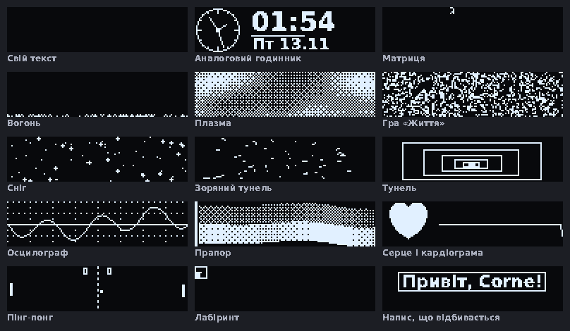

[English](README.md) · **Українська**

</div>

---

## Зміст

- [Можливості](#можливості)
- [Системи](#системи)
- [Вікно](#вікно)
- [Дані з комп'ютера](#дані-з-компютера)
- [Малювання](#малювання)
- [Вбудовані режими](#вбудовані-режими)
- [Як це працює](#як-це-працює)
- [Встановлення](#встановлення)
- [Команди](#команди)
- [Мова](#мова)
- [Корисно знати](#корисно-знати)
- [Структура](#структура)

## Можливості

|  |  |
|---|---|
| 🖥️ **Режим кожного екрана** | статус, корабель, вихованець, еквалайзер, годинник/CPU/музика, картинка — окремо для кожної половини |
| ✨ **19 заготовок** | свій текст (будь-якою мовою), температури й батарея, спектр і хвиля звуку, Bongo-кіт, аналоговий годинник, матриця, вогонь, плазма, гра «Життя», сніг, зоряний тунель, тунель, осцилограф, прапор, серце з кардіограмою, пінг-понг, лабіринт, напис, що відбивається |
| ⌨️ **Розкладка** | після перемикання мови на екрані на мить з'являється EN / UA |
| 🎵 **Звук** | справжній спектр і хвиля того, що грає на комп'ютері |
| 🐱 **Bongo-кіт** | б'є лапками з кожним натисканням і показує швидкість друку |
| 🌡️ **Датчики** | температура процесора й відеокарти (або SSD), завантаження, RAM, заряд батареї |
| 🎨 **Малювання** | олівець, фігури, заливка, текст, кадри анімації, 15 ефектів, малювання наживо просто на клавіатурі |
| 🖼️ **Картинки й GIF** | PNG, JPG, GIF, BMP, WebP; розсіювання для півтонів, поріг, інверсія, кадрування |
| ⏱️ **Годинник і трек** | час, завантаження CPU і RAM, назва треку з плеєра |
| 📺 **Потік кадрів** | будь-що 128×32 зі stdin: відео через `ffmpeg`, свої генератори, ігри |
| ⌨️ **Без вікна** | фонова служба тримає екрани живими, а всі дії доступні з терміналу |
| 🪶 **Легкий** | Rust; служба з анімацією «Вогонь» — близько 0,4 % CPU і 6 МБ RAM |

## Системи

Основна система — Linux. Збірки для Windows і macOS нові й експериментальні — відгуки з реальних
Windows і macOS дуже допоможуть.

| | Linux | Windows | macOS |
|---|:---:|:---:|:---:|
| Режими екранів, картинки, GIF, малювання, заготовки, потік кадрів | ✅ | ✅ | ✅ |
| Годинник, завантаження CPU і RAM | ✅ | ✅ | ✅ |
| Розкладка на екрані | ✅ KDE Plasma | ✅ | ✅ |
| Назва треку | ✅ MPRIS | ✅ системне медіа | ✅ Spotify, Music |
| Спектр і хвиля звуку | ✅ PipeWire / PulseAudio | ✅ WASAPI | ✅ через [BlackHole](https://github.com/ExistentialAudio/BlackHole) |
| Bongo-кіт від натискань | ✅ | ✅ | ✅ «Моніторинг вводу» |
| Батарея | ✅ | ✅ | ✅ |
| Температури CPU / GPU | ✅ | — | — |
| Пауза, поки відкритий Vial | ✅ | — | — |

## Вікно

Три вкладки: режими екранів із живим переглядом заготовок, малювання, свої картинки й GIF.

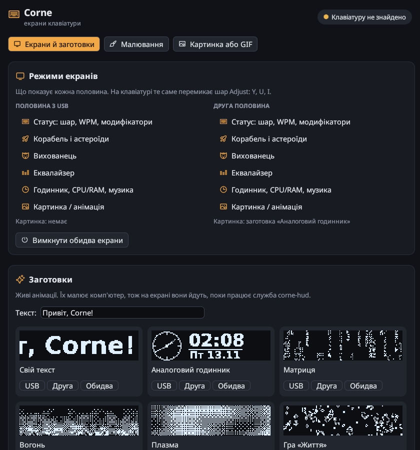

## Дані з комп'ютера

| | |
|:---:|:---:|
| 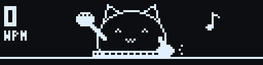<br>**Bongo-кіт** — лапки б'ють з кожним натисканням, зліва швидкість друку, без дії засинає | 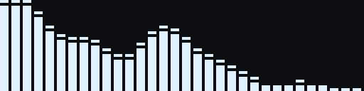<br>**Спектр звуку** — 32 смуги від 40 Гц до 16 кГц, автопідсилення (на демо — тестовий сигнал) |

- **Розкладка.** Після перемикання мови на екрані на 0,8 с з'являється `EN`, `UA` тощо, потім повертається
  попередній режим. Працює в KDE Plasma (D-Bus `org.kde.keyboard`) і Windows. У вікні можна вимкнути показ або вибрати половину.
  Поверх вбудованих режимів — з прошивкою протоколу 2 (папка `firmware/`); зі старішою — лише на екрані з картинкою чи заготовкою.
- **Звук** захоплюється з виходу за замовчуванням і лише поки увімкнена звукова заготовка:
  у Linux через `parec` або `pw-record` (PipeWire / PulseAudio), у Windows через WASAPI loopback. macOS не дає програмам
  записувати системний звук напряму, тож поставте [BlackHole 2ch](https://github.com/ExistentialAudio/BlackHole),
  створіть у «Налаштуванні Audio-MIDI» *пристрій із кількома виходами* (динаміки + BlackHole) і виберіть його виходом;
  corne-hud знайде BlackHole сам (macOS один раз попросить доступ до мікрофона).
- **Котик** рахує лише натискання та їхній час, без того, які саме клавіші. У Linux читає `/dev/input`, потрібна група `input`
  або правило udev з `packaging/70-corne-hud.rules`, яке відкриває доступ тільки до Corne.
  У Windows — низькорівневий хук клавіатури (без прав адміністратора); натискань у вікнах, запущених від адміністратора, не бачить.
  У macOS потрібен дозвіл «Моніторинг вводу» (Системні параметри → Приватність і безпека), macOS попросить його сама.
- **Назва треку** — з будь-якого MPRIS-плеєра через `playerctl` у Linux, із системного медіа у Windows
  (той плеєр, що показується біля регулятора гучності) і зі Spotify або Music у macOS (macOS один раз попросить дозвіл).
- **Датчики:** `coretemp` / `k10temp` / `zenpower`, відеокарта `amdgpu` / `nouveau` (якщо немає — SSD `nvme`), батарея з `/sys/class/power_supply`.
  У Windows і macOS заготовка показує завантаження CPU, RAM і батарею: температури там потребують прав адміністратора або драйвера.
- **Розкладка** в macOS читається з налаштувань джерел вводу (`com.apple.HIToolbox`).

## Малювання

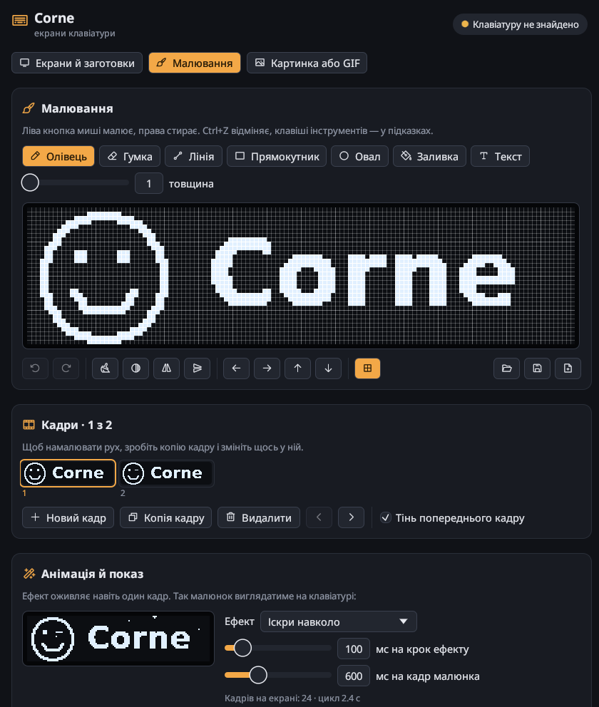

- **Інструменти:** олівець `B`, гумка `E`, лінія `L`, прямокутник `R`, овал `O`, заливка `F`, текст `T`.
  Права кнопка миші робить протилежне: олівцем стирає, заливкою заливає чорним.
- **Правки:** відмінити / повторити (`Ctrl+Z`, `Ctrl+Shift+Z`), очистити, інвертувати, віддзеркалити,
  перевернути, зсунути на піксель.
- **Кадри:** новий, копія, видалення, перестановка; попередній кадр видно тінню, щоб малювати рух.
- **Наживо:** кожен штрих одразу з'являється на вибраному екрані клавіатури.
- **Файли:** відкрити картинку чи GIF як основу, зберегти результат у PNG або GIF.
- Малюнок зберігається сам і чекає наступного відкриття вікна.

**Ефекти** оживляють навіть один кадр. Кадри малюнка й ефект мають окремі швидкості, тож анімований малюнок
може ще й біжати рядком чи іскритися:

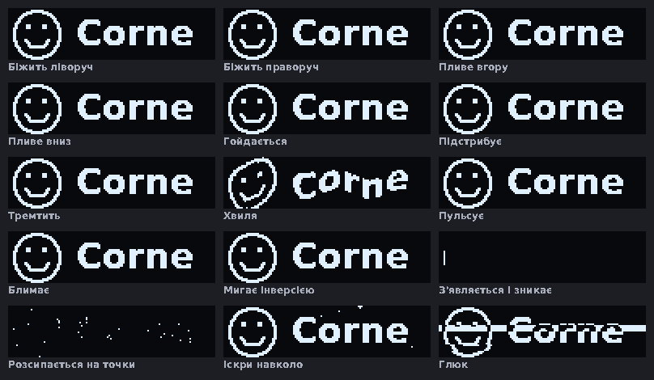

Відкрити вікно одразу на малюванні: `corne-hud draw` (або дія «Малювання» в меню застосунків).

## Вбудовані режими

Ці режими малює сама прошивка, вони працюють і без комп'ютера:

| | |
|:---:|:---:|
| 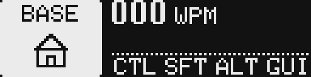<br>**Статус** — шар, WPM, модифікатори | 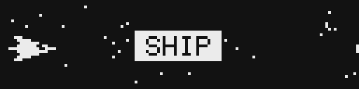<br>**Корабель** — летить швидше, коли друкуєте |
| 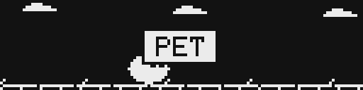<br>**Вихованець** — бігає від набору, спить у тиші | 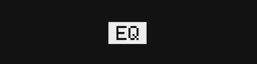<br>**Еквалайзер** — стовпчики від натискань |
| 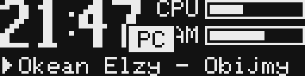<br>**Годинник, CPU/RAM, музика** — дані від corne-hud | |

Перемикання з клавіатури: шар Adjust, `Y` / `U` / `I` (деталі — у [firmware/README.md](firmware/README.md)).

## Як це працює

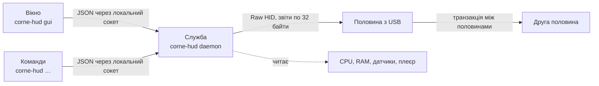

- **Служба** одна на систему: тримає Raw HID клавіатури, малює заготовки, шле годинник і трек,
  перепідключається сама і повертає картинки на екрани після перезапуску.
- Сокет — Unix-сокет у Linux і macOS, `127.0.0.1:47653` у Windows. Клавіатура в Linux — через `/dev/hidraw*`, деінде — через hidapi.
- Кадр — 512 байт. Передаються **лише змінені шматки** по 28 байт, тож анімації йдуть до 20 кадрів на секунду.
- Друга половина отримує кадри від головної шматками по 60 байт.
- Протокол описано в [PROTOCOL.md](PROTOCOL.md).

## Встановлення

### 1. Прошивка

`corne-hud` працює з прошивкою з папки [`firmware/`](firmware/README.md): Vial/QMK для Corne v3 на RP2040 Pro Micro.
Готові `.uf2` для лівої й правої половини — у [релізах](https://github.com/OlexiyOdarchuk/corne-hud/releases).

### 2. Програма

Завантажте з [останнього релізу](https://github.com/OlexiyOdarchuk/corne-hud/releases/latest):

| Система | Файл | Встановлення |
|---|---|---|
| Debian, Ubuntu, Mint | `corne-hud_*_amd64.deb` / `_arm64.deb` | `sudo apt install ./corne-hud_*.deb` |
| Fedora, openSUSE | `corne-hud-*.x86_64.rpm` / `.aarch64.rpm` | `sudo dnf install ./corne-hud-*.rpm` |
| Arch | [`packaging/aur/PKGBUILD`](packaging/aur/PKGBUILD) | `makepkg -si` у цій папці |
| Будь-який Linux | `corne-hud-*-x86_64.AppImage` | `chmod +x` і запустити; додати правило udev (крок 3) |
| Будь-який Linux | `corne-hud-*-x86_64.flatpak` | `flatpak install --user corne-hud-*.flatpak`; додати правило udev (крок 3) |
| Будь-який Linux | `corne-hud-*-linux-*.tar.gz` | програма, ярлик, служба й правило udev |
| Windows 10/11 | `corne-hud-*-windows-x86_64.zip` або `.exe` | просто запустити, драйвер не потрібен |
| macOS 11+ | `corne-hud-*-macos-universal.dmg` | перетягнути *Corne HUD* у «Програми» |

Пакети `.deb`, `.rpm` і AUR самі ставлять правило udev і службу користувача.

Збірки поки без цифрового підпису. Windows SmartScreen може попередити: *Докладніше → Усе одно запустити*.
У macOS перший раз відкрийте програму через правий клік → *Відкрити* або виконайте
`xattr -dr com.apple.quarantine "/Applications/Corne HUD.app"`. Команди — у
`"/Applications/Corne HUD.app/Contents/MacOS/corne-hud"`, є й окремий архів `-cli.tar.gz`.

**З коду** — потрібен [Rust](https://rustup.rs) 1.88+:

```sh
cargo install --git https://github.com/OlexiyOdarchuk/corne-hud
```

Необов'язково в Linux: `playerctl` (назва треку), `parec` або `pw-record` (спектр звуку), `busctl` і KDE Plasma (розкладка),
`fontconfig` з будь-яким шрифтом Sans (текст у заготовках і малюванні).

### 3. Доступ до клавіатури без root (Linux)

Пакети роблять це самі. Для AppImage, Flatpak, архіву й `cargo install` додайте правило udev.
Воно дає доступ до Raw HID (екрани) і до натискань саме Corne (для котика):

```sh
curl -LO https://raw.githubusercontent.com/OlexiyOdarchuk/corne-hud/main/packaging/70-corne-hud.rules
sudo install -Dm644 70-corne-hud.rules /etc/udev/rules.d/70-corne-hud.rules
sudo udevadm control --reload && sudo udevadm trigger
```

Назва файлу важлива: правила з `uaccess` мають іти раніше за `73-seat-late.rules`. Старе `99-corne.rules`, якщо є, видаліть.

Windows і macOS нічого такого не потребують.

### 4. Меню застосунків і автозапуск (Linux, `cargo install`)

```sh
# ярлик і значок (повний шлях: меню не бачить ~/.cargo/bin із налаштувань шелу)
sed "s|^Exec=corne-hud|Exec=$HOME/.cargo/bin/corne-hud|" packaging/corne-hud.desktop \
  > ~/.local/share/applications/io.github.OlexiyOdarchuk.CorneHud.desktop
install -Dm644 packaging/icons/corne-hud.svg \
  ~/.local/share/icons/hicolor/scalable/apps/io.github.OlexiyOdarchuk.CorneHud.svg

# служба разом із входом у систему: годинник і анімації працюють і без відкритого вікна
install -Dm644 packaging/corne-hud.service ~/.config/systemd/user/corne-hud.service
systemctl --user enable --now corne-hud
```

З пакетом `.deb` / `.rpm` / AUR потрібна лише остання команда: `systemctl --user enable --now corne-hud`.

Без автозапуску служба стартує сама, щойно відкрити вікно або виконати будь-яку команду.

## Команди

```sh
corne-hud                                   # вікно
corne-hud draw                              # вікно, одразу на малюванні
corne-hud status                            # стан клавіатури та екранів

corne-hud screen side pet                   # main | side | both  ×  status ship pet eq pc image
corne-hud presets                           # список заготовок
corne-hud preset fire --screen side
corne-hud text "Слава Україні!" --screen main

corne-hud image cat.gif --screen main       # --fit contain|cover|stretch, --no-dither --threshold 100, --invert
corne-hud clear                             # прибрати картинки
corne-hud off / on                          # вимкнути / увімкнути екрани
```

`main` — половина, підключена до USB, `side` — друга.

### Потік кадрів

512 байт на кадр у форматі екрана, або `--gray` — 4096 байт (128×32, байт на піксель):

```sh
ffmpeg -re -i video.mp4 \
  -vf "scale=128:32:force_original_aspect_ratio=decrease,pad=128:32:(ow-iw)/2:(oh-ih)/2" \
  -f rawvideo -pix_fmt gray - | corne-hud stream --gray --screen side
```

## Мова

Інтерфейс — українською та англійською. За замовчуванням береться мова системи; змінити можна в меню з глобусом
у правому верхньому куті вікна або змінною `CORNE_HUD_LANG=uk` / `en` для одного запуску.

Переклади — у [`locales/`](locales). Щоб додати мову, скопіюйте `locales/en.yml` у `locales/<код>.yml`,
перекладіть і додайте код до `LANGS` у [`src/i18n.rs`](src/i18n.rs). `cargo test` перевіряє, що ключі в усіх файлах однакові.

## Корисно знати

- Картинки й заготовки зберігаються в теці налаштувань (`~/.config/corne-hud/` у Linux,
  `~/Library/Application Support/corne-hud/` у macOS, `%APPDATA%\corne-hud\` у Windows) і повертаються на екран після перепідключення.
  Сама клавіатура їх не пам'ятає: без служби режим «картинка» після вимкнення порожній.
- Шрифт вбудованого режиму «Годинник» лише ASCII, тож кирилиця в назвах треків показується латиницею.
  Заготовки й малювання використовують шрифт комп'ютера і показують будь-яку мову.
- Коли клавіатуру відкриває **Vial** (застосунок або vial.rocks), служба стає на паузу і продовжує, щойно Vial закриють:
  клавіатура відповідає на кожен пакет усім, хто її відкрив, і Vial сприйняв би чужу відповідь за свою.
  Це працює в Linux; у Windows і macOS перед роботою з Vial закрийте службу (`corne-hud daemon` у диспетчері завдань / Моніторингу системи).

## Структура

```
src/
  main.rs       команди
  gui.rs        вікно
  paint.rs      вкладка малювання
  draw.rs       фігури, кадри, ефекти анімації
  presets.rs    заготовки-анімації
  live.rs       заготовки з даними: звук, котик, датчики
  audio.rs      захоплення звуку і спектр (FFT)
  keys.rs       натискання для котика
  pixfont.rs    піксельний шрифт 3×5
  daemon.rs     фонова служба
  device.rs     hidraw: пошук клавіатури, передача кадрів
  ipc.rs        запити між вікном/командами і службою
  oled.rs       формат кадру, перетворення картинок, PNG/GIF
  media.rs      GIF для цього README (corne-hud docs-media docs/media)
  sysinfo.rs    CPU, RAM, температури, батарея, трек, розкладка
  platform.rs   відмінності систем: тека налаштувань, шрифти, Flatpak, AppImage
  i18n.rs       мова інтерфейсу
locales/        переклади
firmware/       прошивка Vial (QMK) і симулятор екранів
packaging/      файли для deb/rpm/AUR/AppImage/Flatpak/macOS, служба systemd, ярлик, правило udev, значки
docs/media/     GIF і знімки для цього README
```

Перевірка: `cargo test` (фігури, заливка, ефекти, історія змін, заготовки, FFT, розбір D-Bus, переклади).
Знімки вікна для README: `docs/screenshots.sh uk` (малює у прихованому вкладеному KWin).
Релізи збирає [`.github/workflows/release.yml`](.github/workflows/release.yml), коли з'являється тег `v*`.

## Ліцензія

Програма — [MIT](LICENSE). Прошивка в `firmware/` — GPL-2.0-or-later, як і QMK, на якому вона побудована.
